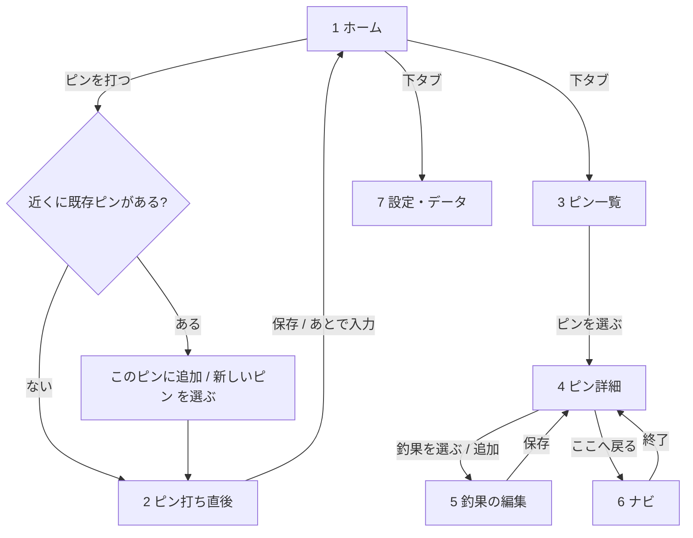

# tsuri-pin 仕様書

船釣り用の「釣果ピン記録」Webアプリ（PWA）の仕様書です。
この文書が承認されてから、最後の「9. 作業計画」の段階ごとに実装します。

- 版: 0.1（2026-11-24 作成）
- 状態: 承認済み。段階7（仕上げ）と、追加の「ピンの地図」まで実装済み。残りは Android と海上での通し確認
- 公開URL: https://youjizero11-cpu.github.io/tsuri-pin/

---

## 1. 概要

### 1.1 何をするアプリか
釣れた場所でボタンを1回押すと、その瞬間の位置（緯度経度）と日時が保存されます。
次に船を出すとき、保存したピンを選ぶと、そこまでの距離と方角が表示されます。
釣った魚の写真やサイズなども、ピンにひもづけて残せます。

### 1.2 使う人と端末
| 人 | 端末 | 役割 |
|---|---|---|
| 友人（船釣りをする人） | Android（Chrome） | **海で実際に使う本番端末** |
| 依頼者（開発する人） | iPhone（Safari） | 開発中の確認、デモ用 |

どちらの端末でも全機能が動くことを目標にします。

### 1.3 使用環境と設計方針
| 環境 | 設計方針 |
|---|---|
| 海上は電波が届かない | 完全オフラインで動く。サーバーは使わず、データは端末の中だけに保存する |
| 濡れた手・揺れる船 | ボタンは大きく（最小でも縦64px、主ボタンは画面幅いっぱい）。ピンを打つのは1タップ |
| 直射日光 | 白背景に黒文字、主ボタンは濃い色。細い文字や薄い灰色は使わない |
| 電池を節約したい | GPSは必要なときだけ動かし、終わったら止める |
| 海上では入力が面倒 | ピンだけ先に打ち、詳細は帰ってから編集できる |

### 1.4 技術方針
- PWA（ホーム画面に追加して、アプリのように使うWebページ）
- HTML / CSS / JavaScript のみ。ビルドツール、フレームワーク、外部ライブラリは使わない
- JavaScriptは「ESモジュール」（ファイルを分けて `import` で読み込む、ブラウザ標準の仕組み）で書く
- データ保存は IndexedDB（ブラウザに備わっている端末内データベース）
- Service Worker でオフライン動作
- 公開先は GitHub Pages（HTTPS）

---

## 2. 画面

### 2.1 画面一覧
ページは `index.html` の1枚だけです。中に全画面が入っていて、必要な画面だけを表示します。
画面の下には、いつでも押せる大きなタブ「ホーム／一覧／設定」を置きます。

| # | 画面 | 役割 | 主な部品 |
|---|---|---|---|
| 1 | ホーム | ピンを打つ。アプリを開いたら最初に出る | 巨大な「ピンを打つ」ボタン、GPSの状態（精度 ±○m）、ピンの地図（2.6）、直近のピン3件 |
| 2 | ピン打ち直後 | 保存できたことを伝え、最小限の釣果を入力する | 「保存しました」の表示、魚種、匹数、写真ボタン、「あとで入力」ボタン |
| 3 | ピン一覧 | 過去のピンを探す | 日付順のリスト（新しい順）、魚種での絞り込み |
| 4 | ピン詳細 | 1つの場所の情報と、そこでの釣果の履歴を見る | 緯度経度と精度、ピン名、メモ、釣果のリスト、「ここへ戻る」「釣果を追加」「地図で開く」「ピンを削除」 |
| 5 | 釣果の編集 | 釣果1件の詳細を入力・修正する | 写真、魚種、サイズ、匹数、水深、タナ、仕掛け/エサ、メモ、日時、「削除」 |
| 6 | ナビ | 選んだピンへ戻る | 距離（大きな数字）、方角の矢印、GPS精度、「終了」 |
| 7 | 設定・データ | 表示の設定と、データの出し入れ | 距離の単位、座標の形式、近接判定の距離、書き出し・読み込み、保存データの件数、使用容量、最後のバックアップ日時、ホーム画面から起動しているか、アプリの版 |

### 2.2 画面遷移



### 2.3 「ピンを打つ」の動き
1. ボタンを押すと、その瞬間からGPSの取得が始まる（詳細は 4.1）
2. 既存のピンが近く（初期値 50m 以内）にあるかを調べる
   - **ない** → 新しいピンを作る
   - **ある** → 「〇〇（32m先）に追加」「新しいピンにする」の大きな2つのボタンを出す。5秒何も押さなければ「追加」を選んだことにする
3. ピンと、空の釣果1件が保存される（この時点で保存は完了。以降の入力はすべて任意）
4. 「ピン打ち直後」画面で魚種と匹数だけ入力できる。「あとで入力」を押せばそのまま終わる

### 2.4 「地図で開く」ボタン（2026-11-24 追加）
ピン詳細画面のボタンを押すと、その緯度経度でGoogleマップが開きます。ピンの位置が合っているかを確かめるためのものです。

- **電波があるときだけ使える。** 圏外のときは「電波のある場所で使えます」と表示して、開かない
  - iPhoneでは、機内モードでもアプリからは「つながっている」と見えることがある。その場合はアプリの表示の代わりに、iPhone自身が「ネットワークに接続していません」と表示する（2026-11-24 実機で確認）。どちらの場合も地図は開かず、データにも影響しない
- **押したときだけ、そのピンの位置がGoogleに送られる。** 「データは端末の外に出さない」方針の例外（ほかには、ピンの地図の「Googleマップで見る」だけ）。ボタンの下にその旨を書いておく
- アプリの中に地図を表示する機能ではない（アプリの中の地図は 2.6）

### 2.6 ピンの地図（2026-11-24 追加）
ホーム画面の「ピンを打つ」ボタンの下に、ピンの場所を示す地図を置きます。並びは上から「ピンを打つ → 地図 → 最近のピン」です。ボタンの大きさは変えません（海の上でいちばん失敗できない操作のため）。

日本全体の表示は、地図の画像を使わず、日本の輪郭のデータから自分で描きます。海域の表示は、電波のあるときは国土地理院の地図（地理院タイル・標準地図）を背景に重ね、圏外のときは輪郭だけで描きます。どちらも圏外で動きます。

外に伝わる情報は2つです。海域の表示を電波のある場所で開くと、見ている範囲が国土地理院のサーバーに伝わります（地図の画像を取りに行くため）。ピンの位置そのものが送られるのは、「Googleマップで見る」を自分で押したときだけです。

| 表示 | 内容 |
|---|---|
| 日本全体 | 九州〜北海道の輪郭の上に、ピンのある場所を印で示す。近いピンは1つの印にまとめて件数を書く。沖縄・奄美は、紙の地図と同じように左上の枠に分けて描く（本来の位置に描くと本州が小さくなるため）。どちらにも入らない場所（小笠原など）にピンがあれば、そこまで自動で広げる |
| 海域 | 印を押すと、その印のピンだけを拡大して位置関係を示す。北が上、縮尺の棒つき。丸の番号は下の一覧と同じ。丸か一覧の行を押すとピン詳細が開く。電波のあるときは国土地理院の地図が背景に出る（2026-11-24 追加。地図と重なるよう、この表示だけメルカトル図法で計算する）。圏外で、表示範囲が100kmより狭いときは、左上に、まわり約250kmの小さな地図（広域図）を出して、どのあたりの海かが分かるようにする |

- 海域の表示で「現在地を表示」を押すと、現在地（ひし形）と、いちばん近いピン、各ピンまでの距離が出る。GPSは押したときだけ使う
- 日本の輪郭は Natural Earth（1:5000万、パブリックドメイン）から日本の部分だけを取り出したもの。約19KB
- **輪郭はおおまかで、数kmのずれがある。小さな島は入っていない。** 海域の表示では、どのあたりの海かを知る目安として、陸地をうすい灰色と点線で描く（おおよその形だと見て分かるようにするため）。ピンが狭い範囲に集まっていると、陸地が画面に入らず白いままのこともある。岩や浅瀬を避ける目的には使えない
- 海域の表示の「Googleマップで見る」を押すと、本物の地図でその海域が開く（電波のある場所だけ）。ピンが1つならその位置に印が付く。2つ以上なら海域の真ん中を同じくらいの広さで開き、印は付かない。**押したときだけ、その位置がGoogleに送られる**
- ピン1つの場所を確かめたいときは、ピン詳細の「地図で開く」も使える

### 2.7 海の深さを見る（2026-11-24 追加）
ホーム画面のいちばん下に「HONDEXの海図を開く」ボタンを置きます。本多電子（HONDEX）の「Web海図」（https://map.hondex.co.jp/）をブラウザで開くだけのリンクです。

- **海図のデータはアプリに取り込まない。** 同サイトの注意事項で、複製・加工・二次利用、ナビゲーションシステムへの利用、機械的な手段でのデータ収集、なぞって地図を作ることが禁止されているため。アプリの中に表示する、深さを読み取る、押した場所を受け取る、といった連動はしない
- 電波のある場所でだけ使える。圏外ではその旨を出す
- このアプリのピンや釣果は送られない（ふつうのリンクなので、サイトを開いたこと自体は相手のサーバーに伝わる）
- 公的な水深データ（JODCの500mメッシュ、海しるAPIの等深線）も調べたが、どちらも申請や利用条件の確認が必要で、今は使っていない

### 2.8 行きたい場所を先に登録する（2026-11-24 追加）
その場にいなくてもピンを作れる画面です（`#plan`）。ホーム画面のいちばん下の「行きたい場所をピンにする」から開きます。HONDEXの海図などで決めた場所を登録し、海の上で「ここへ戻る」を使うためのものです。

| 決め方 | 内容 |
|---|---|
| 地図で決める | 国土地理院の地図（地理院タイル・標準地図）を指で動かし、真ん中の十字を行きたい場所に合わせる。2本指か「広く／くわしく」ボタンで拡大・縮小。「現在地へ移動」もある |
| 数字で決める | 緯度・経度を入力すると、十字がその場所へ移動する。10進（`33.6586, 130.2368`）と度分（`33°39.512′N 130°14.208′E`）の両方を読める |

- 地図の下の「地図／写真」で、標準地図と、空から撮った写真（地理院タイル・シームレス空中写真）を切り替えられる。岸の近くでは、浅瀬や岩が色の違いで見えることがある。撮った時期は場所によって違い、沖合は写真が無いか粗い
- 「この場所をピンにする」で、**予定のピン**（`planned: true`）として保存する。名前は「予定 11/24 22:50」の形で自動で付く。保存後はピン詳細が開く
- 予定のピンは、位置の後ろに「±○m」ではなく「（予定の場所）」と出す。ピンの地図では紺色の印にする。CSVの「精度m」欄には「予定」と書く
- **予定のピンは、「近くのピンに追加しますか」の候補にしない。** 目で決めたおおよその場所なので、そこに釣果を足すと、実際に釣れた正確な位置が残らない。現地で「ピンを打つ」を押せば、GPSの正確な位置で新しいピンができる
- **目で合わせるので、数十〜数百mずれる。** 近くまで行くためのもので、最後は現地の魚探で合わせる前提
- 地図に海の深さは出ない。HONDEXの海図と連動はしていない（2.7のとおり、できない）。2つを見比べて使う
- **地図は電波のある場所でしか出ない。** 数字での登録と保存は圏外でもできる。保存したあとのナビは圏外でも動く
- **地図を表示している間、見ている範囲が国土地理院のサーバーに伝わる。** 「データは端末の外に出さない」方針の例外。ピンや釣果は送られない。画面にその旨を書く
- 地図の部品は外部ライブラリを使わず自作（`js/screens/plan.js`）。地図の右下に出典「地図：国土地理院」を出す
- Service Worker は、よそのサイトのファイル（地図の画像）には手を出さない（保存もしない）

### 2.5 入力の工夫
- 魚種は、前に入力したことのある名前を候補として出す（1〜2タップで選べる）
- 数字の項目は、数字キーボードが出るようにする
- 削除は必ず確認を出す（ピンを削除すると、ひもづく釣果と写真も消える）

---

## 3. データ

### 3.1 保存場所
端末内の IndexedDB。データベース名は `tsuri-pin`、中に4つの「箱」（オブジェクトストア）を作ります。

1つのピン（場所）に、複数の釣果がひもづきます。釣果1件には写真が1枚まで付きます。

```
pins（場所） 1 ──< catches（釣果） 1 ── 0..1 photos（写真）
```

### 3.2 pins（ピン＝場所）
| 項目 | 型 | 例 | 説明 |
|---|---|---|---|
| id | 文字列 | `"3f2a…"` | 自動で振る重複しないID（UUID） |
| name | 文字列 | `"ピン 11/24 06:12"` | 自動で付け、あとで変更できる |
| lat | 数値 | `34.205750` | 緯度（10進、北が＋） |
| lon | 数値 | `135.123456` | 経度（10進、東が＋） |
| accuracyM | 数値 | `6` | GPSの誤差の目安（メートル）。予定のピンでは `0` |
| planned | 真偽 | `true` | 予定のピン（行く前に地図や数字で登録した場所）なら `true`。「ピンを打つ」で作ったピンには無い |
| memo | 文字列 | `"かけあがりの手前"` | 場所についてのメモ |
| createdAt | 文字列 | `"2026-11-24T06:12:33+09:00"` | 作成日時（ISO 8601形式） |
| updatedAt | 文字列 | 同上 | 最終更新日時 |

### 3.3 catches（釣果）
| 項目 | 型 | 例 | 説明 |
|---|---|---|---|
| id | 文字列 | UUID | |
| pinId | 文字列 | UUID | どのピンの釣果か |
| caughtAt | 文字列 | ISO 8601 | 釣れた日時（ボタンを押した時刻。あとで変更可） |
| species | 文字列 | `"マダイ"` | 魚種。空でもよい |
| sizeCm | 数値 / 空 | `42` | サイズ（cm） |
| count | 数値 / 空 | `2` | 匹数 |
| depthM | 数値 / 空 | `65` | 水深（m） |
| tana | 文字列 | `"底から3m"` | タナ（魚がいた層）。書き方が人により違うので文字で持つ |
| rig | 文字列 | `"タイラバ 80g オレンジ"` | 仕掛け/エサ |
| memo | 文字列 | | 自由メモ |
| hasPhoto | 真偽 | `true` | 写真があるか |
| updatedAt | 文字列 | ISO 8601 | 最終更新日時 |

### 3.4 photos（写真）
| 項目 | 型 | 説明 |
|---|---|---|
| catchId | 文字列 | どの釣果の写真か（これがキー） |
| blob | 画像データ | 縮小後のJPEG |

- 「写真を撮る」は端末標準のカメラを直接呼び出す（`<input type="file" accept="image/*" capture="environment">`）
- 「写真を選ぶ」は端末に保存済みの写真から選ぶ（帰ってから入力するとき用）
- 保存前に、長辺 1280px・JPEG品質 0.8 に縮小する（1枚あたり約200〜400KBの見込み）
- 写真を別の箱に分けるのは、一覧表示のときに重い画像を読まずに済ませるため

### 3.5 settings（設定）
| キー | 初期値 | 選択肢 |
|---|---|---|
| distanceUnit | `"m"` | `"m"`（m/km） / `"nm"`（海里。近づいたらm） |
| coordFormat | `"dm"` | `"dm"`（度分 `34°12.345′N`） / `"dd"`（10進 `34.20575`） |
| nearbyM | `50` | 近接判定の距離（m）。`0` / `20` / `50` / `100` / `200` から選ぶ。0 で判定なし |

保存される緯度経度は常に10進です。設定で変わるのは見せ方だけです。

### 3.6 書き出し・読み込み
| 形式 | 用途 | 中身 |
|---|---|---|
| CSV | 表計算ソフトで見る | 釣果1件＝1行。ピンの名前・緯度・経度・精度も各行に入れる。写真は含まない。Excelで文字化けしないよう「BOM付きUTF-8」で出す |
| JSON | バックアップ、機種変更 | ピン・釣果・設定の全部と、形式の版番号。写真は「含める／含めない」を選べる（含める場合は文字列に変換して埋め込む） |

- CSVの列: `釣れた日時, ピン名, 緯度, 経度, 精度m, 魚種, サイズcm, 匹数, 水深m, タナ, 仕掛け/エサ, メモ, ピンのメモ`
- ファイル名: `tsuri-pin_2026-11-24.csv` / `.json`
- 書き出しは、共有メニュー（LINE・メール・ファイルに保存など）が使える端末ではそれを開き、使えない端末ではダウンロードする
- 読み込みはJSONのみ。IDで突き合わせ、同じIDがあれば `updatedAt` が新しい方を残す。読み込む前に「ピン○件・釣果○件を取り込みます」と確認を出す
- 釣果のないピンも、場所だけの行としてCSVに出す（場所の記録を落とさないため）
- 共有メニューは「ボタンを押した直後」にしか開けない決まりがある。ファイル作りに時間がかかって開けなかったときは、「保存・共有する」ボタンを出してもう一度押してもらう
- 共有メニューに渡せるファイルの種類は端末で違う。渡せない場合（AndroidのChromeでのJSONなど。実機で要確認）はダウンロードになり、「ダウンロード」フォルダに入る
- 読み込みで合流させるのはピン・釣果・写真。表示の設定は端末ごとの好みなので、読み込んでも変えない
- 写真を含まないファイルを読み込んだとき、この端末に同じ釣果の写真があればそれを残す
- 削除の記録は持たない。削除したピンが古いバックアップに入っていれば、読み込むと戻る
- 中身がおかしい行（緯度経度が数値でない、対応するピンがない釣果など）は取り込まない
- CSVの読み込みはMVPでは作らない（CSVは見るため、JSONは戻すため、と役割を分ける）

---

## 4. 位置情報とナビ

### 4.1 ピンを打つときのGPS
- ボタンを押した瞬間から、高精度モードでGPSを取り始める
- 最大10秒のあいだ届いた値のうち、最も誤差の小さいものを採用する。誤差10m以下の値が来たらその時点で打ち切る
- 終わったらGPSを止める（電池の節約）
- 誤差が30mを超えていたら「精度が低いです（±○m）」と表示する。保存はする
- 1つも取れていない間は、最大30秒まで待つ（圏外で久しぶりにGPSを使うと、最初の1回に時間がかかるため）
- 30秒待っても1つも取れなかったら保存せず、「位置が取れませんでした」と原因の候補（位置情報の許可、空が見えているか）を表示する

### 4.2 ナビ
- ナビ画面を開いているあいだだけGPSを連続で取る。画面を閉じたら止める
- 距離と方位は、2点の緯度経度から計算する（ハーバーサインの公式。通信は不要）
- 距離の表示: 1000m未満は `350 m`、それ以上は `2.4 km`。海里の設定なら `1.3 NM`、0.1海里未満はm表示
- 現在のGPS誤差より近づいたら「到着（誤差の範囲内）」と表示する
- ナビ中は画面が消えないようにする（Wake Lock）。対応していない端末では、その旨を表示する

### 4.3 方角の表示
矢印は「いまスマホを向けている方向から見て、ピンがどちらにあるか」を指します。

| 端末 | 方法 | 注意 |
|---|---|---|
| Android（Chrome） | `deviceorientationabsolute` イベントで方位を取る | 許可は不要 |
| iPhone（Safari） | `DeviceOrientationEvent.requestPermission()` で許可を求め、`webkitCompassHeading` で方位を取る | **許可はボタンを押した直後にしか求められない**。ナビ画面に「コンパスを使う」ボタンを置く |

- スマホのコンパスは、船の金属やエンジンの近くで狂うことがある。そのため、矢印の基準を**「コンパス」と「進行方向（GPS）」でボタンで切り替えられる**ようにする
  - コンパス基準：スマホの向きを使う。止まっていても使える（初期値）
  - 進行方向（GPS）基準：船が進んでいる向きを使う。動いているとき（およそ時速2km以上）だけ矢印が出る。金属の影響を受けない
  - コンパスが使えない端末や、許可されなかった場合は、自動で進行方向（GPS）基準になる
- コンパスが使えない・許可されなかった場合は、矢印の代わりに「北から○度（北東）」と数字と方位名で表示する
- 画面に「8の字に振ると精度が上がります」の案内を出す

---

## 5. ファイル構成

```
tsuri-pin/
├─ index.html              画面の骨組み（全画面がこの中に入っている）
├─ manifest.webmanifest    ホーム画面に追加するための設定（名前・アイコン・色）
├─ sw.js                   Service Worker。オフライン用にファイルを保存する係
├─ css/
│   └─ style.css           見た目（大きなボタン、高コントラスト）
├─ js/
│   ├─ app.js              最初に動く。画面の切り替えと、Service Workerの登録
│   ├─ util.js             小さな道具（IDを作る、日時の形式をそろえる）
│   ├─ db.js               IndexedDBの読み書き（保存・取得・削除）
│   ├─ geo.js              GPSの取得、距離と方位の計算、座標の表示形式
│   ├─ compass.js          コンパス（iPhoneの許可処理を含む）
│   ├─ photo.js            写真の受け取りと縮小
│   ├─ pinmap.js           ホーム画面の「ピンの地図」（日本全体と、海域の拡大）
│   ├─ japan.js            日本の輪郭のデータ（Natural Earth から取り出したもの）
│   ├─ settings-store.js   設定を覚えておく係（読み込み・保存）
│   ├─ export.js           CSV/JSONの書き出し、JSONの読み込み
│   └─ screens/
│       ├─ home.js         ホーム画面、ピン打ち直後の画面
│       ├─ list.js         ピン一覧
│       ├─ plan.js         行きたい場所を先に登録する（地図を動かす・数字で指定）
│       ├─ pin.js          ピン詳細
│       ├─ catch.js        釣果の編集
│       ├─ nav.js          ナビ
│       └─ settings.js     設定・データ
├─ icons/                  アプリアイコン（192px、512px、iPhone用180px）
├─ README.md               アプリの説明と使い方（公開用）
├─ SPEC.md                 この仕様書
└─ .gitignore              公開しないファイルの指定（書き出したデータなど）
```

ファイルの役割分担の考え方:
- `screens/` の各ファイルは「画面に何を出すか、ボタンを押したら何をするか」だけを書く
- 保存はすべて `db.js`、位置はすべて `geo.js` を通す。こうすると、不具合のときに見る場所がすぐ分かる
- GitHub Pages では `https://ユーザー名.github.io/tsuri-pin/` のようにフォルダ付きのURLになるため、ファイルの参照はすべて相対パス（`./js/app.js`）で書く

---

## 6. オフライン動作の仕組み

### 6.1 仕組み（やさしい説明）
ふつうのWebページは、開くたびにインターネットからファイルを取ってきます。だから圏外では開けません。

このアプリでは **Service Worker** という「ブラウザの中に住む受付係」を使います。

1. **初回（電波のある場所）**: アプリを開くと、受付係がアプリのファイル一式（HTML・CSS・JS・アイコン）を端末の中の倉庫（キャッシュ）にしまう
2. **2回目以降**: アプリがファイルを欲しがると、受付係がまず倉庫から渡す。インターネットには取りに行かない。だから圏外でも開ける
3. **記録したデータ**: ピンや写真は、倉庫とは別の IndexedDB に保存される。最初から端末の中にあるので、通信は一切使わない
4. **GPS**: 衛星からの電波を受けるだけなので、携帯の電波がなくても使える

### 6.2 アプリを更新するとき
`sw.js` の中の版番号（例 `v3` → `v4`）を書き換えて公開すると、次に電波のある場所で開いたときに倉庫の中身が新しくなります。
いまの版番号は設定画面に表示します。

新しい版の確認は、次の3つのタイミングで行われます。新しい版が見つかると、取り込みが終わりしだい画面が自動で読み込み直されます。
- アプリを開いたとき
- 別のアプリから戻ってきたとき（スマホでは、閉じたつもりでも裏で開いたままのことが多いため）
- 設定画面の「最新版を確認」ボタンを押したとき

### 6.3 使う人が知っておくこと
アプリの設定画面と README にも同じ内容を載せます。

- **出港前に、電波のある場所で一度アプリを開く**（最新のファイルを倉庫に入れるため）
- **データは端末の中にしかない。** 端末の故障・紛失・ブラウザのデータ削除で消える。定期的に JSON を書き出して保管する
- **iPhone は必ずホーム画面に追加して使う。** Safari で開いたままだと、長く使わなかったときにデータが消されることがある
- 圏外で長時間たってからGPSを使うと、最初の測位に時間がかかることがある（数十秒〜数分）
- アプリ起動時に、ブラウザへ「このデータを勝手に消さないで」と依頼する（`navigator.storage.persist()`）。聞き入れられるかは端末しだい

---

## 7. 動作確認の手順

### 7.1 パソコンで確認する（開発中）
1. `tsuri-pin` フォルダで簡易サーバーを起動する
   ```powershell
   python -m http.server 8000
   ```
2. ブラウザで `http://localhost:8000` を開く
3. パソコン（localhost）では、直した内容がすぐ画面に出るよう Service Worker を止めてある。オフライン動作を試すときだけ `http://localhost:8000/?sw=1` で開く
4. 位置情報は Chrome の開発者ツール（F12 →「センサー」）で好きな場所に変えて試せる

`index.html` をダブルクリックして開く方法では動きません（位置情報とService Workerは、HTTPS か `localhost` でしか使えないため）。

### 7.2 Android（Chrome）— 友人の本番端末
1. 公開URLを Chrome で開く
2. メニュー（︙）→「ホーム画面に追加」（または「アプリをインストール」）
3. ホーム画面のアイコンから起動する
4. 位置情報の許可を求められたら「アプリの使用時のみ」→「正確な位置情報」をオンにする
5. **機内モードにして**、アプリを一度終了し、もう一度起動できることを確認する
6. ピンを打つ → 釣果と写真を入れる → 一覧に出る → ナビで矢印が動く、を順に確認する

### 7.3 iPhone（Safari）— 依頼者の端末
1. 公開URLを **Safari** で開く（Chrome などではホーム画面追加の動きが違う）
2. 共有ボタン（□に↑）→「ホーム画面に追加」
3. ホーム画面のアイコンから起動する
4. 位置情報の許可で「アプリの使用中は許可」を選ぶ。「正確な位置情報」がオンになっていること
5. ナビ画面で「コンパスを使う」ボタンを押し、「動作と方向へのアクセス」を許可する
6. 7.2 の 5〜6 と同じ確認をする

### 7.4 ナビの確認方法（陸上で）
1. 屋外の開けた場所（公園など）でピンを打つ
2. 100m以上歩いて離れる
3. ナビを開き、距離が歩いた分とおおよそ合っているか、矢印がピンの方向を指すかを見る
4. ピンへ歩いて戻り、距離が減っていき、最後に「到着」が出るかを見る

### 7.5 海上での通し確認（友人のAndroid）
出港前に一度開く → 圏外でピンを打つ → 写真を撮る → 別の場所へ移動 → ナビで戻る → 帰港後に JSON と CSV を書き出す。

---

## 8. GitHub Pages への公開手順

### 8.1 公開してよいもの
このフォルダ（`tsuri-pin`）の中のアプリ本体だけです。次のものはリポジトリに入れません。
- 実際の釣果データ（書き出した CSV / JSON）。釣り場の位置は人に知られたくない情報です
- 個人名、連絡先
- このフォルダの外にある資料

書き出しファイルを誤って入れないよう、`.gitignore` に `tsuri-pin_*.csv` と `tsuri-pin_*.json` を書いておきます。

### 8.2 手順
1. GitHub で新しいリポジトリ `tsuri-pin` を作る（Public。無料プランでは Pages の公開に Public が必要）
2. このフォルダをリポジトリにして送る
   ```powershell
   git init
   ```
   ```powershell
   git add .
   ```
   ```powershell
   git commit -m "最初の版"
   ```
   ```powershell
   git branch -M main
   ```
   ```powershell
   git remote add origin https://github.com/ユーザー名/tsuri-pin.git
   ```
   ```powershell
   git push -u origin main
   ```
3. GitHub のリポジトリ画面 → Settings → Pages → 「Deploy from a branch」→ ブランチ `main`、フォルダ `/(root)` → Save
4. 1〜2分待つと `https://ユーザー名.github.io/tsuri-pin/` で開ける
5. 以後は、変更して `git push` するたびに自動で反映される（`sw.js` の版番号を上げるのを忘れない）

---

## 9. 作業計画

各段階の終わりに動くものができ、確認してから次へ進みます。
基本は依頼者の iPhone とパソコンで確認し、★の段階では友人の Android でも確認します。

| 段階 | 作るもの | 確認すること |
|---|---|---|
| 1 | 骨組み。画面の切り替え、下タブ、見た目の土台、ホーム画面追加の設定、Service Worker、GitHub Pages への公開 | スマホでURLを開ける。ホーム画面に追加できる。機内モードでも起動する |
| 2 ★ | ピンを打つ。GPSの取得、IndexedDB への保存、ホームに直近のピンを表示 | ボタンを押すと位置と時刻が保存され、アプリを閉じても残っている。Android でも保存できる |
| 3 | 釣果の記録。ピン打ち直後の最小入力、釣果の編集画面、写真の撮影と縮小、近くのピンへの追加。釣果を後から開くための入口として、ピン詳細の最小版（釣果のリストと「釣果を追加」）もここで作る | 写真付きの釣果を保存・修正・削除できる。同じ場所で2回押すと「追加」を選べる |
| 4 | ピン一覧と詳細。日付順の表示、魚種での絞り込み、ピン名とメモの編集、ピンの削除、「地図で開く」ボタン | 過去のピンを探して、その場所の釣果の履歴を見られる。「地図で開く」でGoogleマップに正しい場所が出る |
| 5 ★ | ナビ。距離と方角、コンパス（iPhone の許可を含む）、画面消灯の防止 | 7.4 の手順で、歩いてピンへ戻れる。iPhone と Android の両方で矢印が正しい |
| 6 | 設定とデータ。単位と座標形式の切り替え、CSV/JSON の書き出し、JSON の読み込み | CSV を Excel で開ける。JSON を別の端末で読み込むと同じデータになる |
| 7 ★ | 仕上げ。日光下での見やすさの調整、エラー表示の見直し、README、全機能の通し確認 | 機内モードで 7.2・7.3 の全項目が通る。その後、海上で 7.5 を行う |

実装中は、各段階の始めに「これから何を作るか」、終わりに「何ができたか・どう確認するか」を短く説明します。

---

## 10. 将来の拡張候補（今回は作らない）

| 候補 | 内容 | 補足 |
|---|---|---|
| くわしい地図の表示 | 海岸線や地名の入った本物の地図に、ピンを重ねる | 輪郭だけの簡易な地図は 2.6 で実装済み。くわしい地図を圏外で使うには、地図の画像（タイル）を事前に端末へ保存する仕組みが必要 |
| 海底地形図・等深線 | 深いエリアを地図に重ねて見る | 使えるデータの入手先と利用条件の確認が先に必要 |
| AIによる魚種判別 | 写真から魚種を自動入力する | 帰港後、電波があるときに実行する。サーバーかAIサービスの利用が必要になる |
| 潮・天気の自動補完 | ピンの日時と位置から、潮回りや天気を後から付ける | 同上 |
| ARでサイズ計測 | カメラをかざして魚の長さを測る | 端末ごとの対応差が大きい |
| 友人とのポイント共有 | ピンを他の人と共有する | サーバーが必要。まずは JSON ファイルの受け渡しで代用できる |
| CSVの読み込み | 表計算で直したデータを戻す | |
| 釣果1件に複数の写真 | | |
